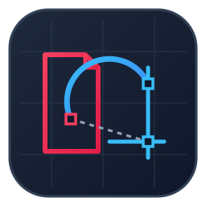

# VectorBridge CAD Studio

A PyQt6 desktop application for converting vector PDF drawings into editable,
metric DXF files, with optional DWG conversion through the
[ODA File Converter](https://www.opendesign.com/guestfiles/oda_file_converter).

## License

This project is licensed under the [MIT License](./LICENSE).

## Run

```powershell
python -m pip install -r requirements.txt
python main.py
```

## Windows release

The standalone Windows executable bundles Python and the application
dependencies. Build it on Windows with:

```powershell
python -m pip install -r requirements-build.txt
python build_windows.py
```

The output is `dist\VectorBridgeCADStudio.exe`. The SVG logo is used for the
application and window icons, and is bundled into the executable. ODA File
Converter is not bundled; install it separately if DWG export is needed.

To build a Windows setup installer, first install Inno Setup 6, then run:

```powershell
.\build_installer.ps1
```

This creates `dist\VectorBridgeCADStudio-Setup.exe`, which installs per-user
under `%LOCALAPPDATA%\Programs`, adds a Start Menu shortcut, and optionally
creates a desktop shortcut. The installed application does not require Python.

Add PDF files with **Add PDFs** or drag them into the queue. Choose `.dxf` or
`.dwg` for each file, optionally choose an output directory, configure layer
and/or source-RGB mappings to an ACI or TrueColor, then start the batch. The
queue remains scrollable while work runs; the overall progress bar and **Abort**
button track and stop the batch. If ODA is not installed, a DWG request
completes as a DXF fallback and reports that in the queue.

## Conversion behavior

- Coordinates and line widths are converted from PDF points to millimeters;
  document units are set to millimeters.
- PDF vector paths and searchable text spans are extracted. PDF optional-content
  layers are preserved for drawings and text when supplied by the PDF.
- Page rotation and text direction are applied to the DXF geometry and text.
- Cubic curves are sampled and fitted to circles/arcs only when the maximum
  radial error is at most 0.01 mm. Other curves remain polylines.
- Closed filled paths are written as solid DXF hatches.
- PDF text remains editable `TEXT`; glyph fonts and exact CAD text styling are
  not recoverable from a PDF and may differ.
- Embedded PDF raster images are exported as DXF `IMAGE` references. Their PNG
  files are placed in a sibling `<drawing>_assets` folder, which must stay
  alongside the DXF or DWG when the drawing is moved. DXF/DWG image references
  are external; the drawing file itself does not contain the raster bytes. The
  conversion queue identifies the asset folder in the completed job status.
- Text that the PDF stores only as glyph outlines has no embedded string to
  recover. Such outlines remain vector geometry; this converter does not use
  OCR to guess text.
- Raster-only content, gradients, advanced hatch patterns, and full BIM/CAD
  semantics are not reconstructed. PDF drawing metadata is inherently lossy.
- Multi-page drawings are placed below one another with a small gap.

The [ODA File Converter](https://www.opendesign.com/guestfiles/oda_file_converter)
is optional and must be installed separately. The application looks for
`ODAFileConverter` on `PATH` and in common Windows ODA installation folders.

## Tests

```powershell
python -m unittest discover -s tests
```
